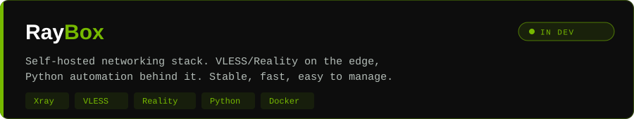

<div align="center">



<br>


</div>

<br>


I build games, Android apps and the networking behind them.
The common thread is performance: smooth frames, fast connections, clean code.

```console
$ cat stack.txt
gamedev     Unity, C#           mechanics, 3D logic, interactive systems
mobile      Kotlin              personal Android apps for everyday problems
backend     Python              Telegram bots, automation, scripts
network     Xray / VLESS        secure custom VPN setups
```

<br>


<div align="center">
  &nbsp;&nbsp;
  &nbsp;&nbsp;
  &nbsp;&nbsp;
  &nbsp;&nbsp;
  &nbsp;&nbsp;
  &nbsp;&nbsp;
  &nbsp;&nbsp;
  
</div>

<br>


<a href="https://github.com/voidjd/RayBox">
  
</a>

<br>

<div align="center">

**Ask me about:** Unity · Kotlin · Python · Linux · Anime


</div>
