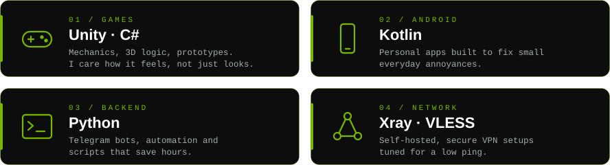
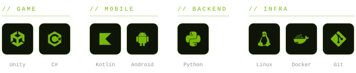

 

 

**Developer from Russia.** I like the things you can feel but can't see: frame time, latency, an app that starts before you blink.

 

 

 

**Ask me about:** Unity · Kotlin · Python · Linux

